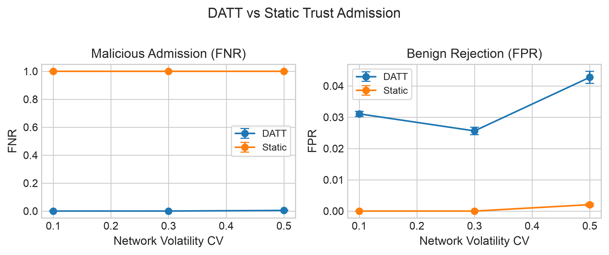
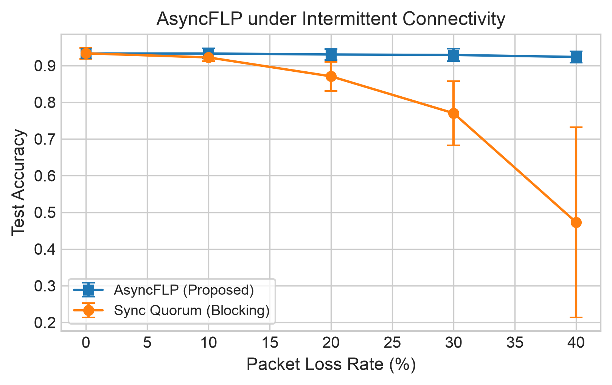
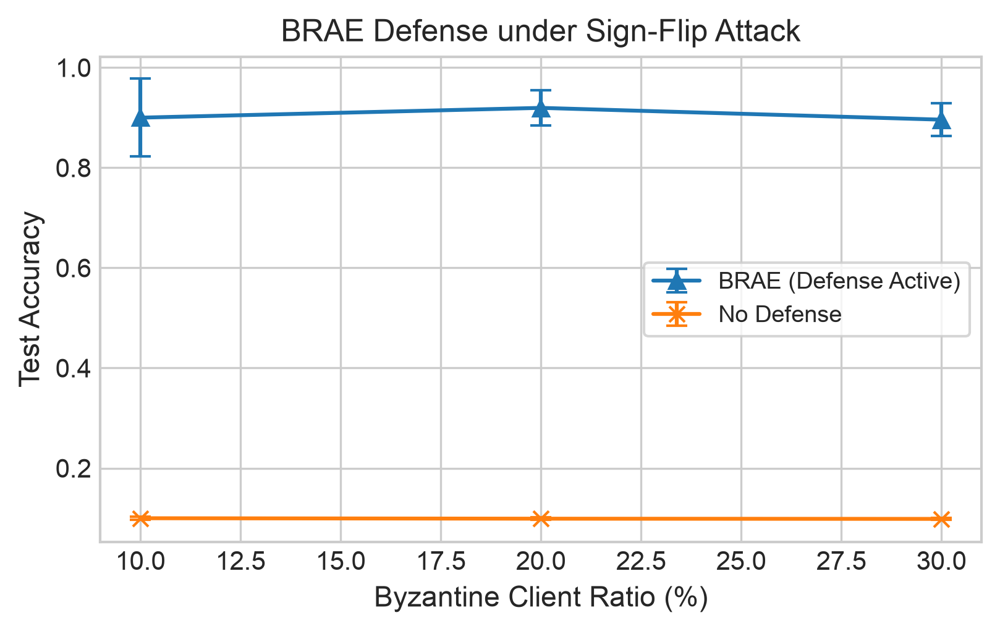
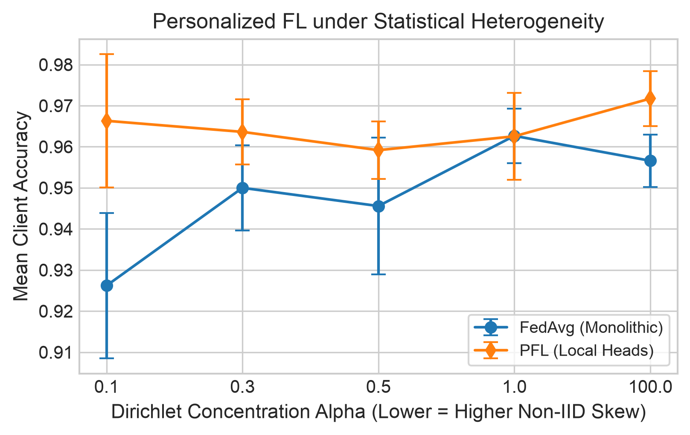
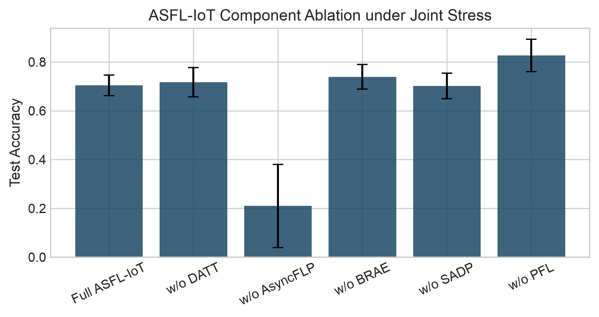
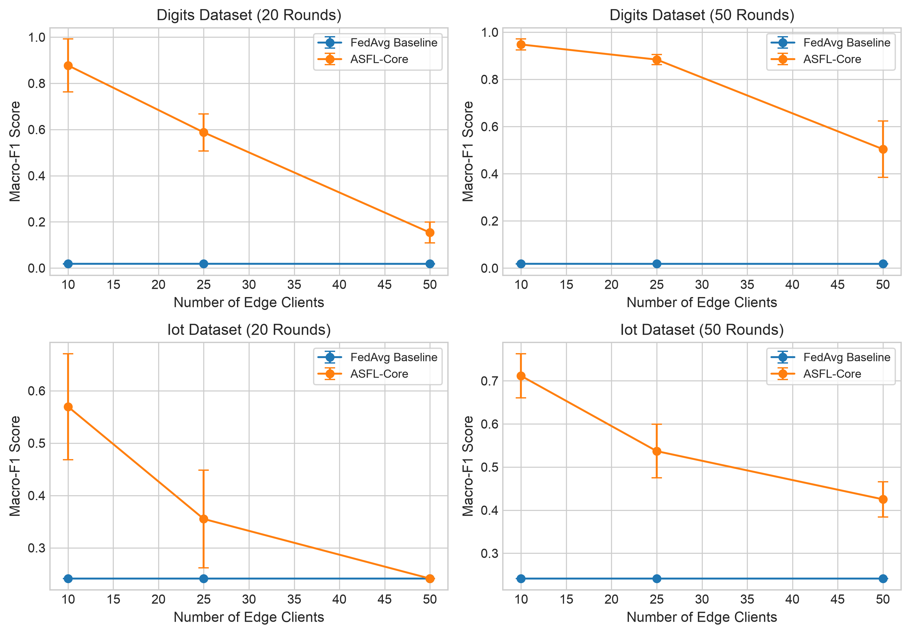

<div align="center">

# 🛡️ ASFL-IoT

### Risk-Coupled Adaptive Secure Federated Learning<br/>for Trust-Aware Internet-of-Things Systems

[-1B4965?style=for-the-badge&logo=ieee)](docs/acceptance.md)

[](https://python.org)
[](https://pytorch.org)
[](LICENSE)
[](.github/workflows/ci.yml)

**Official open-source repository** for the IEEE conference paper, accepted for the<br/>
*2026 IEEE International Conference on Emerging Trends in Science and Technology (ICES&T 2026)*.

[Overview](#-executive-summary) •
[Architecture](#️-system-architecture--round-lifecycle) •
[Results](#-key-empirical-findings) •
[Quick Start](#-quick-start--installation) •
[Reproduce](#-reproducing-experiments) •
[Cite](#-paper--citation)

</div>

---

## ✨ Highlights

<div align="center">

| 🎯 Trust Attacks | 📡 Packet Loss | ☠️ Byzantine Poisoning | ⚖️ Non-IID Fairness |
|:---:|:---:|:---:|:---:|
| **99.56%** ↓ malicious admission | **+45.1%** accuracy at 40% loss | **+79.7%** accuracy recovery | **+13.2%** gain on minority clients |

</div>

---

## 📌 Executive Summary

Federated Learning (FL) allows Internet-of-Things (IoT) edge devices to collaboratively train predictive models without centralizing raw sensor observations. However, real-world edge IoT deployments jointly suffer from five simultaneous vulnerabilities:

1. **Adversarial Trust Warming:** Malicious edge nodes artificially inflate trust reputation before injecting poisoned updates.
2. **Volatile Connectivity & Packet Loss:** Unstable radio links cause synchronous FL rounds to block indefinitely.
3. **Byzantine Model Poisoning:** Compromised clients upload sign-flipped or extreme gradient perturbations.
4. **Gradient Privacy Leakage:** Model parameters transmitted over edge channels expose sensitive training records.
5. **Statistical Non-IID Skew:** Heterogeneous sensor modalities and local device distributions degrade monolithic global models.

Existing solutions treat these stressors in isolation, often causing defenses to interfere (e.g., differential privacy noise corrupting Byzantine outlier detection, or strict admission thresholds causing quorum stalls).

**ASFL-IoT** introduces a coordinated, risk-coupled 5-stage federated round lifecycle that harmonizes trust admission, staleness decay, Byzantine filtering, layer-sensitive differential privacy, and personalized local heads into one cohesive framework.

---

## 🏗️ System Architecture & Round Lifecycle

```mermaid
flowchart LR
    subgraph Clients["Edge IoT Fleet"]
        C["IoT Edge Clients<br/>Local Data & Sensors"]
    end

    subgraph Coordinator["ASFL-IoT Central Coordinator"]
        DATT["1. Risk-Coupled DATT<br/>Dynamic Trust Admission"]
        BRAE["2. BRAE Filtering<br/>MAD Norm + Cosine Screen"]
        ASYNC["3. AsyncFLP Aggregation<br/>Staleness Decay Weighting"]
        SADP["4. SADP Privacy<br/>Layer-Sensitive DP Noise"]
        GLOBAL["Shared Representation<br/>Body Parameters"]
    end

    subgraph LocalPFL["Client Personalization"]
        PFL["5. PFL Heads<br/>Private Local Classifier"]
    end

    C -->|"Upload Updates"| DATT
    DATT -->|"Admitted Clients"| BRAE
    BRAE -->|"Surviving Gradients"| ASYNC
    ASYNC -->|"Aggregated Weights"| SADP
    SADP --> GLOBAL
    GLOBAL -->|"Global Representation"| PFL
    PFL -->|"Private Local Head"| C

    BRAE -.->|"Risk Feedback"| DATT

    style DATT fill:#e8f4f8,stroke:#1B4965,stroke-width:2px
    style BRAE fill:#fbeee9,stroke:#E76F51,stroke-width:2px
    style ASYNC fill:#eaf7f5,stroke:#2A9D8F,stroke-width:2px
    style SADP fill:#fff3cd,stroke:#ffc107,stroke-width:2px
    style GLOBAL fill:#e9ecef,stroke:#6c757d,stroke-width:2px
    style PFL fill:#eaf7f5,stroke:#2A9D8F,stroke-width:2px
```



### The 5 Core Modules

| Module | Name | Key Mechanism | Targeted Failure Mode |
|---|---|---|---|
| **DATT** | Dynamic Adaptive Trust Thresholding | Interquartile Range (IQR) volatility scaling + trust-warming drift penalty $\lambda_d$ + anomaly penalty $\lambda_a$ | Trust-warming adversaries climbing score history |
| **AsyncFLP** | Asynchronous Federated Protocol | Exponential staleness decay $q_i = \exp(-\lambda \tau_i)$ with dynamic weight normalization | Radio packet loss & device sleep stalls |
| **BRAE** | Byzantine-Robust Aggregation | Coordinate-wise Median Absolute Deviation (MAD) distance gating + cosine direction filtering | Sign-flip, Gaussian, and model-replacement attacks |
| **SADP** | Sensitivity-Aware Differential Privacy | Layer-sensitive noise budget allocation ($\phi_\ell$) preserving representation features | Gradient inversion & membership inference |
| **PFL** | Personalized Federated Learning | Split architecture: shared feature body $G$ with client-retained local heads $P_i$ | Non-IID Dirichlet label skew & extreme imbalance |

---

## 📊 Key Empirical Findings

All metrics were evaluated across **5 random seeds** (`[1, 7, 21, 42, 100]`) and report mean $\pm$ standard deviation.

| Stress Scenario | Baseline | ASFL-IoT Module | Baseline Result | ASFL-IoT Result | Impact / Gain |
|---|---|---|---|---|---|
| **Trust Warming Attack** ($CV=0.50$) | Static Threshold (0.55) | **Risk-Coupled DATT** | $\text{FNR} = 1.000 \pm 0.000$ | $\mathbf{0.0044 \pm 0.0017}$ | **99.56% reduction** in malicious admission |
| **Wireless Packet Loss** (40% loss) | Sync Quorum Blocking | **AsyncFLP** | $0.473 \pm 0.259$ | $\mathbf{0.924 \pm 0.016}$ | **+45.1% accuracy**, zero round stalls |
| **Byzantine Poisoning** (30% Sign-Flip) | No Defense | **BRAE** | $0.099 \pm 0.002$ | $\mathbf{0.896 \pm 0.033}$ | **+79.7% accuracy** recovery under heavy attack |
| **Statistical Heterogeneity** ($\alpha=0.10$) | FedAvg Global Model | **PFL (Local Heads)** | $0.926 \pm 0.018$ (worst: $0.751$) | $\mathbf{0.966 \pm 0.016}$ (worst: $\mathbf{0.883}$) | **+13.2% fairness gain** on minority clients |
| **Rare-Event Sensor Imbalance** (IoT) | FedAvg Global Model | **Full ASFL-IoT** | Macro-F1: $0.241 \pm 0.000$ | $\mathbf{0.551 \pm 0.066}$ | **+31.0% Macro-F1** on minority sensor faults |
| **Differential Privacy** ($\epsilon=0.7$) | Fixed DP (Isotropic) | **SADP (Layer-Sensitive)** | $0.934 \pm 0.013$ | $\mathbf{0.932 \pm 0.016}$ | Preserves utility while concentrating privacy budget |

---

## 📈 Visual Benchmark Gallery

All plots are reproducible via `scripts/generate_plots.py` and exported in both vector PDF and high-res PNG:

<table align="center">
  <tr>
    <td align="center" width="50%">
      
      <br/><b>Figure 1: Risk-Coupled DATT vs Static Admission</b><br/>
      <i>DATT suppresses malicious admission (FNR) to &lt;0.005 while bounding benign rejection.</i>
    </td>
    <td align="center" width="50%">
      
      <br/><b>Figure 2: AsyncFLP under Intermittent Connectivity</b><br/>
      <i>AsyncFLP maintains &gt;92% test accuracy even under severe 40% radio packet loss.</i>
    </td>
  </tr>
  <tr>
    <td align="center" width="50%">
      
      <br/><b>Figure 3: BRAE Byzantine Resilience</b><br/>
      <i>Recovers from catastrophic failure (9.9%) under up to 30% malicious sign-flip clients.</i>
    </td>
    <td align="center" width="50%">
      
      <br/><b>Figure 4: Personalized FL under Non-IID Skew</b><br/>
      <i>Local classification heads deliver sustained gains across severe Dirichlet partitions (&alpha;=0.1).</i>
    </td>
  </tr>
  <tr>
    <td align="center" width="50%">
      
      <br/><b>Figure 5: Component Ablation Study</b><br/>
      <i>Demonstrates necessity of coordinated defenses under joint network and security stressors.</i>
    </td>
    <td align="center" width="50%">
      
      <br/><b>Figure 6: Scalability & Model Capacity Sweeps</b><br/>
      <i>Macro-F1 across 10, 25, and 50 clients over 20 vs 50 rounds and wider MLPs (hidden=384).</i>
    </td>
  </tr>
</table>

---

## 📁 Repository Structure

```
├── .github/
│   ├── workflows/ci.yml         # GitHub Actions automated CI testing workflow
│   ├── ISSUE_TEMPLATE/          # Standardized issue templates
│   │   ├── bug_report.md
│   │   └── feature_request.md
│   └── PULL_REQUEST_TEMPLATE.md # Contribution PR guidelines
│
├── asfl_iot/                    # Core Python package
│   ├── __init__.py              # Version 1.0.0 and public API exports
│   ├── config.py                # Hyperparameter presets and JSON I/O
│   ├── models.py                # SmallMLP and LargeMLP body/head split architectures
│   ├── dataset.py               # Digits and synthetic IoT data loaders & Dirichlet partitioning
│   ├── datt.py                  # Dynamic Adaptive Trust Thresholding (DATT)
│   ├── brae.py                  # Byzantine-Robust Aggregation (MAD + cosine screening)
│   ├── sadp.py                  # Sensitivity-Aware Differential Privacy (SADP) & fixed DP
│   ├── asyncflp.py              # Staleness-decay weighting and quorum checking
│   ├── pfl.py                   # Personalized Federated Learning local evaluation
│   ├── federated.py             # Main federated simulation coordinator
│   └── metrics.py               # Evaluation metrics, summary tables, and 95% CIs
│
├── notebooks/
│   └── asfl_iot_experiments.ipynb # Interactive, fully documented Jupyter reproduction notebook
│
├── scripts/
│   ├── run_experiments.py       # Modular CLI runner for all benchmark experiments
│   └── generate_plots.py        # Publication figure generator (PDF & PNG)
│
├── results/                     # Precomputed benchmark datasets & logs
│   ├── figures/                 # All 6 publication figures (PDF & high-res PNG)
│   ├── *.csv                    # Raw and summary CSV tables across all 5 seeds
│   └── config.json              # Simulation configuration parameters
│
├── docs/                        # Publication and conference acceptance records
│   └── acceptance.md            # IEEE ICES&T 2026 acceptance notice and review notes
│
├── tests/                       # Automated test suite
│   ├── test_models.py           # Model architectures and parameter manipulation tests
│   ├── test_dataset.py          # Data split and Dirichlet partitioning tests
│   ├── test_datt.py             # DATT admission logic and threshold gating tests
│   ├── test_brae.py             # Byzantine detection and filtering tests
│   └── test_federated.py        # End-to-end multi-round federated simulation test
│
├── .gitignore                   # Comprehensive ignores for Python, PyTorch, LaTeX, macOS
├── CITATION.cff                 # GitHub automated citation metadata
├── citation.bib                 # Ready-to-use BibTeX entry
├── LICENSE                      # MIT Open Source License
├── pyproject.toml               # Modern standard packaging configuration
└── requirements.txt             # Pinned Python package dependencies
```

---

## 🚀 Quick Start & Installation

### 1. Clone the Repository

```bash
git clone https://github.com/omerfarooq223/ASFL-IoT-Research.git
cd ASFL-IoT-Research
```

### 2. Environment Setup

Using `uv` (recommended for ultra-fast setup):
```bash
uv venv .venv
source .venv/bin/activate
uv pip install -r requirements.txt
uv pip install -e .
```

Or using standard `venv` and `pip`:
```bash
python3 -m venv .venv
source .venv/bin/activate
pip install --upgrade pip
pip install -r requirements.txt
pip install -e .
```

### 3. Run the Automated Test Suite

Verify that all unit tests and federated simulation modules pass:
```bash
pytest -v tests/
```

---

## 🔬 Reproducing Experiments

### Option A: Command-Line Interface (CLI)

The reproduction runner `scripts/run_experiments.py` supports running individual suites or the entire pipeline:

```bash
# Run all benchmark experiments across all 5 seeds
python scripts/run_experiments.py --experiment all

# Run specific experiment suites:
python scripts/run_experiments.py --experiment trust       # 1,000-node DATT trust simulation
python scripts/run_experiments.py --experiment async       # Packet loss resilience sweep
python scripts/run_experiments.py --experiment byzantine   # Byzantine poisoning defense sweep
python scripts/run_experiments.py --experiment pfl         # Non-IID Dirichlet concentration sweep
python scripts/run_experiments.py --experiment ablation    # Component ablation study
python scripts/run_experiments.py --experiment iot         # Imbalanced synthetic IoT benchmark

# Custom settings (e.g., faster smoke test with 2 seeds and 10 rounds)
python scripts/run_experiments.py --experiment async --seeds 1 7 --rounds 10
```

### Option B: Interactive Jupyter Notebook

Launch the reproduction notebook locally or in Google Colab / Kaggle:
```bash
jupyter notebook notebooks/asfl_iot_experiments.ipynb
```

### Option C: Regenerate Publication Figures

Recreate all 6 figures from the CSV results into `results/figures/`:
```bash
python scripts/generate_plots.py --results-dir results --fig-dir results/figures
```

---

## 📜 Paper & Citation

> **Note:** The full paper is accepted for publication and will be formally indexed in the IEEE Xplore Digital Library (*Proceedings of the 2026 IEEE International Conference on Emerging Trends in Science and Technology*). For preprint or author-accepted manuscript requests, please reach out to the authors.

If you find this work, codebase, or benchmark useful in your research, please cite:

```bibtex
@inproceedings{zulfiqar2026asfl,
  title={{ASFL-IoT: Risk-Coupled Adaptive Secure Federated Learning for Trust-Aware Internet-of-Things Systems}},
  author={Zulfiqar, Saliha and Farooq, Muhammad Umar and Hussain, Muhammad Zunnurain and Hasan, Muhammad Zulkifl},
  booktitle={Proceedings of the 2026 IEEE International Conference on Emerging Trends in Science and Technology (ICES\&T)},
  year={2026},
  organization={IEEE},
  note={Paper ID: 21}
}
```

---

## 👥 Authors & Affiliations

- **Saliha Zulfiqar** — *Department of Artificial Intelligence, University of Management and Technology, Lahore, Pakistan*
- **Muhammad Umar Farooq** — *Department of Artificial Intelligence, University of Management and Technology, Lahore, Pakistan* (`momerfarooq223@gmail.com`)
- **Muhammad Zunnurain Hussain** (*Senior Member, IEEE*) — *Assistant Professor, Bahria University, Lahore Campus, Pakistan*
- **Muhammad Zulkifl Hasan** (*Senior Member, IEEE*) — *Principal Lecturer, University of Central Punjab, Lahore, Pakistan*

---

## 📄 License

This project is licensed under the terms of the [MIT License](LICENSE).

<div align="center">

⭐ **If this work helps your research, consider starring the repo!** ⭐

<sub>Built for secure, trust-aware federated learning at the IoT edge.</sub>

[⬆ Back to top](#️-asfl-iot)

</div>
